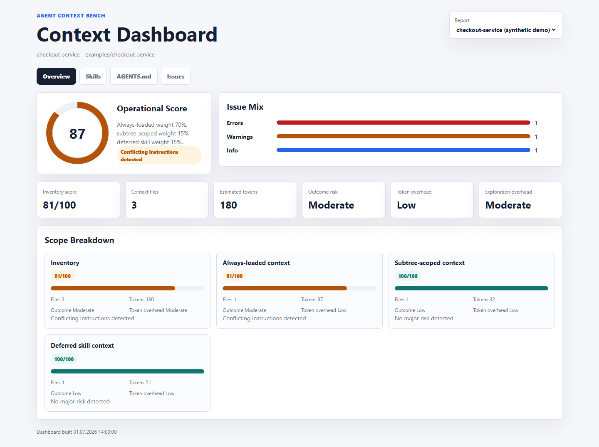

# agent-context-bench

[](https://www.npmjs.com/package/agent-context-bench)
[](https://www.npmjs.com/package/agent-context-bench)
[](https://github.com/ahmtsahin/agent-context-bench/actions/workflows/ci.yml)
[](LICENSE)

Put your `AGENTS.md` and `SKILL.md` files on a diet. Every line of agent context is paid for in tokens on each run — `agent-context-bench` measures that token cost and tells you whether the context is earning its place or just inflating the bill.

`agent-context-bench` is a dependency-light CLI for auditing repository-level agent instructions: `AGENTS.md`, `CLAUDE.md`, `SKILL.md`, `.cursor/rules`, `.cursorrules`, and `.github/copilot-instructions.md`. It estimates the token footprint of each file (with an optional exact tokenizer), breaks the cost down per skill, separates context that loads on **every** task from skills that load only when selected, and flags the bloat, duplication, and conflicts that drive that cost up. Run the [A/B benchmark](#measured-ab-benchmark) to turn those estimates into measured success rates and token counts.

## Quick Start

Requires Node.js 20 or newer.

Run the published CLI:

```bash
npx agent-context-bench
```

Install it globally if you want the shorter alias:

```bash
npm install -g agent-context-bench
context-diet
```

Run it from a source checkout:

```bash
git clone https://github.com/ahmtsahin/agent-context-bench.git
cd agent-context-bench
npm ci
npm run build
node dist/cli.js --help
node dist/cli.js .
```

Example output:

```text
Operational Score: 77/100
Inventory Risk Score: 0/100

Operational weights: always-loaded 80%, deferred skills 20%
Inventory context: 9 files, 924 lines, 112000 bytes, ~28000 tokens
Operational effect on agent:
- Task success: -14%
- Token cost: +31%
- Files explored: +40%
- Commands run: +20%
- Risk: Deferred skill risk: Context bloat detected
Inventory risk effect:
- Task success: -65%
- Token cost: +180%
- Files explored: +140%
- Commands run: +80%
- Risk: Context bloat detected

Always-loaded context: 83/100
- Files expected to be loaded up front: AGENTS.md, CLAUDE.md, Cursor rules, and Copilot instructions.
- Size: 2 files, 180 lines, 28000 bytes, ~7000 tokens

Deferred skill context: 42/100
- SKILL.md files that should be loaded only when a matching skill is selected.
- Size: 7 files, 744 lines, 84000 bytes, ~21000 tokens

Suggested optimized file: AGENTS.optimized.md
Run with --write-optimized to generate it.
```

## What It Checks

- Context bloat: long root instructions, skill instructions, large token footprint, dense lines.
- Conflicting instructions across tests, commits, network access, autonomy, generated files, comments, formatting, and comment/doc language — for example "run all tests" and "avoid full test suites". Conflicts are scope-aware: two skills that never load together, or two unrelated nested `AGENTS.md` files, are not falsely flagged.
- Duplicate rules across `AGENTS.md`, `CLAUDE.md`, Cursor rules, and Copilot instructions, naming the files involved.
- Broken references: inline-code or markdown-link paths with a code/config extension (for example `src/foo.ts`, `config/app.yaml`) that do not exist in the repo, so agents are not sent chasing files that were renamed or never existed.
- Skill metadata quality: missing frontmatter, missing/too-thin/too-long `description`, `name` that does not match the skill folder, and skills that have frontmatter but no body. Skill descriptions are what drive selection, so weak ones hurt and bloated ones add constant token cost.
- Ambiguous test guidance that mentions tests without concrete commands.
- Dangerous instructions such as `rm -rf`, `chmod 777`, `curl | bash`, or concrete secret-file reads (for example `cat .env`).
- Package-manager mismatches such as `pnpm` instructions in an `npm` repo.
- Nested context awareness: a nested `AGENTS.md`/`CLAUDE.md` is noted as loading only when working inside its directory, not for every task.

Reports are split into three buckets: always-loaded root context, subtree-scoped nested `AGENTS.md`/`CLAUDE.md` files, and deferred `SKILL.md` context. When all three exist, the `Operational Score` weights them at 70%, 15%, and 15%; when always-loaded context is paired with only one conditional scope, the weights are 80% and 20%. `Inventory Risk Score` remains the worst-case score if every discovered context file were loaded.

Static analysis gives fast signal without calling a model. When you want measured results instead of estimates, the `run-bench` command runs your agent under different context conditions and records the success rates — see [Measured A/B benchmark](#measured-ab-benchmark).

## Skill Breakdown

When `SKILL.md` files are present, the report includes a per-skill table. Each skill row shows:

- Score: score for that single `SKILL.md` file based on issues attached to that file.
- Estimated tokens: approximate tokens for that file only.
- Token cost: static estimate of extra token pressure from that skill file.
- Task success: static estimate of success drag from that skill file.
- Risk: highest-priority risk category for that skill file.
- Issues: error and warning counts attached to that file.

Terminal output shows the first 20 riskiest or largest skill files. Markdown and JSON reports include all skill rows.
## Metric Model

These numbers are static heuristics, not measured agent runtime results. They are designed to flag likely context risk before you spend model calls. To replace the estimates with measured success rates, run the [A/B benchmark](#measured-ab-benchmark).

- Estimated tokens: `ceil(character_count / 4.28)` for each context file. This is a calibrated approximation based on `o200k_base` tokenizer checks against representative AGENTS.md and SKILL.md reports, not exact tokenizer output for every model.
- Score: starts at `100` and subtracts issue impact points. Error issues cost more than warnings; the final score is clamped to `0..100`.
- Operational Score: weighted score for normal usage. Always-loaded, subtree-scoped, and deferred contexts use 70%/15%/15% when all are present; always-loaded plus one conditional scope uses 80%/20%; subtree-scoped plus deferred uses 50%/50%; a single scope gets 100%.
- Inventory Risk Score: worst-case score across every discovered context file, including all `SKILL.md` files.
- Task success estimate: predicted success drag from context problems. Formula: `-min(65, round((100 - score) / 2 + error_count * 3 + warning_count))`.
- Token cost estimate: predicted extra context/tool cost pressure. Formula: `min(180, round(tokens / 120 + bloat_count * 14 + duplicate_count * 6 + conflict_count * 8))`.
- Files explored estimate: predicted extra file exploration from noisy context. Formula: `min(140, round(bloat_count * 22 + vague_rule_count * 14 + duplicate_count * 8 + conflict_count * 10))`.
- Commands run estimate: predicted extra command churn. Formula: `min(80, round(conflict_count * 12 + test_issue_count * 10))`.

Because these are estimates, a low deferred skill score does not mean every task is slow. It means the installed skill inventory is heavy or risky if the wrong skills are selected or loaded too broadly.
## CLI

```bash
agent-context-bench [path] [options]
context-diet [path] [options]
```

Options:

```text
--format text|json|markdown|dashboard  Report format (default: text)
-o, --output <file>             Write report to a file
--write-optimized [file]        Write a slim AGENTS.md suggestion
--fail-under <score>            Exit 1 when score is below the threshold
--max-lines <n>                 Context bloat line threshold (default: 350)
--max-bytes <n>                 Context bloat byte threshold (default: 14000)
--max-depth <n>                 Nested context file search depth (default: 6)
--baseline <file.json>          Compare scores against a previous JSON report
--exact-tokens                  Use the optional gpt-tokenizer for exact token counts
```

### Config file

Place a `.agent-context-bench.json` in the analyzed repo to set defaults. CLI flags always override config values.

```json
{
  "maxLines": 250,
  "maxBytes": 12000,
  "maxDepth": 4,
  "failUnder": 70,
  "format": "markdown",
  "ignoreDirs": ["fixtures", "examples"]
}
```

### Exact token counts

By default tokens are estimated with a calibrated `chars / 4.28` heuristic. Pass `--exact-tokens` to count with the real `o200k_base` tokenizer. This needs the optional `gpt-tokenizer` package; if it is not installed the CLI prints a warning and falls back to the heuristic.

### Compare against a baseline

Save a JSON report, then compare a later run against it to see whether an edit helped:

```bash
agent-context-bench --format json --output baseline.json
# ...edit AGENTS.md / SKILL.md...
agent-context-bench --baseline baseline.json
```

The text and markdown reports gain a baseline section showing the score, inventory risk, and token deltas.

Generate a proposed slim context file:

```bash
agent-context-bench --write-optimized
```

Generate a Markdown report for CI:

```bash
agent-context-bench --format markdown --output agent-context-report.md --fail-under 70
```

Generate a standalone HTML dashboard for one analysis:

```bash
agent-context-bench --format dashboard --output agent-context-dashboard.html
```

Build a dashboard from existing JSON reports:

```bash
agent-context-bench dashboard reports --output dashboard.html
```

The dashboard includes overview metrics, per-skill rows, top issues, and an `AGENTS.md` preview.

<p align="center">
  
</p>

Generate starter benchmark tasks from git history:

```bash
agent-context-bench generate-bench --from-git-history --limit 20 --output .agent-context-bench/tasks.json
```

The generated tasks identify small historical commits that look like bug fixes, validation fixes, tests, or refactors. They do not mutate the repo; they produce task metadata that the `run-bench` command can execute.

Add `--verify` to vet each candidate before it enters the suite:

```bash
agent-context-bench generate-bench --from-git-history --verify --success "npm test" --output .agent-context-bench/tasks.json
```

A task is kept only when the success command **fails at the base commit** (the bug is really present, so an agent cannot pass by doing nothing) and **passes at the target commit** (the historical fix really solves it). Kept tasks carry `"verified": true`; dropped tasks are logged with the reason. This runs the success command twice per task in an isolated worktree, so it costs test time but removes the noisiest failure mode of history-mined benchmarks: tasks that were never actually broken.

## Measured A/B benchmark

`run-bench` turns the static estimates into measured results. It runs each task three ways — with **no** context, the **current** context, and the **optimized** context — and records whether the success command passes in each case. Success is observed (the exit status of your success command after the agent runs), not estimated.

```bash
agent-context-bench run-bench \
  --agent "your-agent-cli --prompt-from-stdin" \
  --success "npm test" \
  --conditions none,current,optimized
```

- `--agent <cmd>` is the agent CLI to invoke per task. The task prompt is provided on stdin and in the `AGENT_BENCH_PROMPT`, `AGENT_BENCH_CONDITION`, and `AGENT_BENCH_WORKSPACE` environment variables. Commands containing `{prompt}` or `{workspace}` are parsed into executable arguments and substituted without shell interpolation; combine shell pipelines with stdin or the environment variables instead. It runs with the prepared workspace as its working directory.
- `--tasks <file.json>` supplies the task list (the output of `generate-bench`, or a plain JSON array). Without it, tasks are generated from git history.
- `--success <cmd>` is the verification command (default: the repo's test script). A condition counts as successful only when both the agent command and this verification command exit `0`.
- Each condition runs in an isolated workspace: a detached `git worktree` at the task's base commit when available, otherwise a copy of the working tree. The runner mutates only the context files for each condition and cleans up afterward.

Example output:

```text
Bench summary (adapter: command)
- Tasks: 12
- none: 58% success, ~0 context tokens, efficiency 0.58, 186s/task
- current: 50% success, ~21000 context tokens, efficiency 0.16, 314s/task
- optimized: 75% success, ~5200 context tokens, efficiency 0.49, 188s/task
Measured deltas (success-rate points):
- current vs none: -8
- optimized vs current: +25
- optimized vs none: +17
Gold-context metrics (vs files changed by each task's source commit):
- none: edit P/R/F1 0.71/0.66/0.68, explored P/R 0.31/0.83 (12 tasks with gold files)
- current: edit P/R/F1 0.52/0.58/0.55, explored P/R 0.18/0.79 (12 tasks with gold files)
- optimized: edit P/R/F1 0.74/0.70/0.72, explored P/R 0.33/0.85 (12 tasks with gold files)
```

### Gold-context metrics

Tasks generated from git history carry the files their source commit touched. `run-bench` treats those files as the task's **gold context** (the ContextBench idea, without needing human annotation) and measures, per condition:

- **Edited files**: read from `git status` in the task worktree after the agent runs, minus the context files the condition setup itself changed. Edit precision/recall/F1 tell you whether the agent changed the right files.
- **Explored files**: edited files plus workspace files the agent's output mentioned (plain path mentions and `file_path` fields in structured transcripts both match). Explored precision is a best-effort proxy for how much irrelevant wandering the context caused.

Metrics stay `null` when a task has no `filesChanged` or the workspace fell back to a plain copy instead of a git worktree — estimates never masquerade as measurements. The exploration signal depends on how verbose your agent's output is; edit metrics are exact.

### Efficiency

Each condition also gets `efficiency = successRate / (1 + contextTokens / 10000)` — success per unit of context pressure. Two conditions with equal success rates rank by token cost; a condition that buys no success with extra tokens sinks. It is a comparison score between conditions of one run, not a cross-project benchmark number.

### A real measured run

We ran the benchmark against this repo with headless Claude Code (Sonnet): 4 real bugs restored from git history, three context conditions, success = the test suite passing afterwards. Full setup, transcript evidence, caveats, and raw results: [docs/benchmarks/claude-sonnet-2026-07.md](docs/benchmarks/claude-sonnet-2026-07.md).

| Condition | Success | Context tokens | Avg time/task | Agent cost |
| --- | --- | --- | --- | --- |
| No context | 4/4 | 0 | 186s | $5.13 |
| Bloated CLAUDE.md (scores 0/100) | 1/4 | ~3,400 | 314s | $6.04 |
| Optimized context (`--write-optimized`) | 4/4 | ~430 | 188s | $5.01 |

The bloated context — conflicting rules, a package-manager mismatch, references to files that don't exist — cost 75 success points, +69% wall time, and +18% agent spend. The optimized file matched no-context success with 87% fewer tokens than the bloated one. The run also caught a bug in our own generated template (an "ask before network access" rule that stalls headless agents), which is fixed and covered in the writeup.

Each run is recorded to a history store (built-in SQLite, with a JSON Lines fallback) under `.agent-context-bench/history.db`. List past runs with:

```bash
agent-context-bench history --limit 20
```

Use `--no-history` to skip recording, or `--history-file <path>` to choose where it lives.

## GitHub Action

Use this repo as an action:

```yaml
name: Agent Context Bench

on:
  pull_request:
  push:
    branches: [main]

jobs:
  context:
    runs-on: ubuntu-latest
    permissions:
      contents: read
      pull-requests: write
    steps:
      - uses: actions/checkout@v4
      - uses: ahmtsahin/agent-context-bench@v1
        with:
          fail-under: "70"
          write-optimized: "true"
          comment: "true"
```

Create a `v1` tag before using the versioned action reference.

The action writes a Markdown report to the job summary. With `comment: "true"` on a `pull_request` event it also posts (and updates) a PR comment via the `gh` CLI, which needs `pull-requests: write` permission.

## Development

```bash
npm ci
npm run build
npm test
```

The checked-in `dist/` files make the CLI runnable in this workspace without installing dependencies. Source lives in `src/` and is built with `tsc`.

Generated reports are ignored by default. Commit only scrubbed example reports if you want public fixtures.

## Roadmap

- Ship ready-made adapters/presets for Claude Code, Codex CLI, Cursor, and the OpenAI/Anthropic/Gemini APIs on top of the generic command adapter.
- Parse real token/cost usage from agent output instead of an optional reported `TOKENS=` line.
- Trend view in the dashboard built from the run history store.
- Add examples from public repositories.

Done since the first release: scope-aware conflict detection, SKILL.md frontmatter validation, baseline comparison, config file, optional exact tokenizer, PR comments from the GitHub Action, a measured A/B `run-bench` runner with a SQLite/JSONL run-history store, a [measured Claude Code case study](docs/benchmarks/claude-sonnet-2026-07.md) with reproducible fixtures, gold-context precision/recall/F1 metrics and an efficiency score in `run-bench`, and `generate-bench --verify` task vetting.
